<!-- Cabeçalho -->

 

<!-- TODO: troque os links abaixo pelos seus -->

---

## 👋 Sobre mim

Me chamo **João Ricardo**, tenho **20 anos** e sou apaixonado por tecnologia desde cedo, então a escolha foi óbvia: hoje curso **Engenharia de Software na FIAP**.

Tenho nanismo, e isso me deu uma meta bem clara: **treinar a mente todos os dias para que ela seja gigante.** 🧠

- 🎓 Cursando **Engenharia de Software** na FIAP
- 🤝 Aberto a: **estágio**, projetos open source e colaborações

---

## 🛠️ Stack

**Linguagens**

**Frameworks & Bibliotecas**

**Ferramentas**

<!-- TODO: ajuste para o que você usa de verdade -->

---

## 🚀 Projetos em destaque

<!-- TODO: troque pelos seus repositórios e descrições reais -->
| Projeto | Descrição | Stack |
|---|---|---|
| [**Meus Direitos**](https://github.com/joaoricardosoc/meus-direitos) | Global Solution FIAP (2026/2) | React · Node.js · Java |
| [**Merlin Route Finder**](https://github.com/joaoricardosoc/merlin-route-finder) | Challenge Smart Retail Leroy Merlin + FIAP (2026) | React · Node.js · Java |
| [**Yvy**](https://github.com/joaoricardosoc/Yvy) | Global Solution FIAP (2026/1) | React · Node.js · Java |

---

## 📊 Estatísticas

  
  

  

 

<picture>
  <source media="(prefers-color-scheme: dark)" srcset="https://raw.githubusercontent.com/joaoricardosoc/joaoricardosoc/output/pacman-contribution-graph-dark.svg">
  <source media="(prefers-color-scheme: light)" srcset="https://raw.githubusercontent.com/joaoricardosoc/joaoricardosoc/output/pacman-contribution-graph.svg">
  
</picture>

---

  <i>"Não é o tamanho que define até onde você chega, é o quanto você está disposto a aprender."</i>

<!-- Rodapé -->

